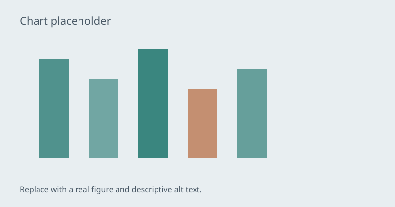

# Applied AI Learning Hub

A public learning portfolio documenting a transition from solution architecture into applied artificial intelligence during the Master Programme in Applied Artificial Intelligence at Luleå University of Technology (2026–2028).

> This is a personal learning portfolio and is **not** an official website of Luleå University of Technology.

## Screenshot

<!-- Add a homepage screenshot after first deployment -->


## Live site

- Project Pages (planned): `https://ahatha.github.io/applied-ai-learning-hub/`
- User site alternative: `https://ahatha.github.io` (if content is published from `ahatha.github.io`)

Update these URLs after GitHub Pages is enabled.

## Purpose

The site functions as:

- A public learning portfolio
- A course-by-course knowledge hub
- An ML / AI project showcase
- A technical blog for study notes
- A career-transition portfolio
- A long-term record of master's studies (2026–2028)

## Features

- Multi-page static site (GitHub Pages ready)
- Light / dark theme with system preference and manual override
- Accessible sticky navigation and mobile menu
- JSON-driven courses, projects, skills, roadmap, resources, and blog metadata
- Client-side filtering and search (no backend)
- Course, project, and blog templates for long-term growth
- Privacy and academic-integrity guidance

## Project structure

```text
/
├── index.html
├── about.html
├── programme.html
├── courses.html
├── roadmap.html
├── projects.html
├── blog.html
├── resources.html
├── contact.html
├── search.html
├── 404.html
├── courses/
├── projects/
├── blog/
├── assets/
│   ├── css/
│   ├── js/
│   ├── data/
│   ├── images/
│   └── icons/
├── docs/DEPLOYMENT.md
├── PRIVACY_CHECKLIST.md
├── ACADEMIC_INTEGRITY.md
├── README.md
├── LICENSE
└── CNAME.example
```

## Local usage

1. Clone the repository.
2. Open `index.html` in a browser.

For JSON-driven pages, a local static server is recommended because some browsers restrict `fetch` on `file://`:

```powershell
# From the repository root (Python example)
python -m http.server 8080
```

Then visit `http://localhost:8080/`.

## Content updates

| Content | Where to edit |
| --- | --- |
| Course catalogue | `assets/data/courses.json` (+ optional `courses/<id>.html`) |
| Projects | `assets/data/projects.json` (+ optional `projects/<id>.html`) |
| Skills | `assets/data/skills.json` |
| Timeline | `assets/data/timeline.json` |
| Roadmap | `assets/data/roadmap.json` |
| Resources | `assets/data/resources.json` |
| Blog metadata | `assets/data/blog.json` (+ `blog/<slug>.html`) |
| Learning areas (home) | `assets/data/learning-areas.json` |

Do not invent grades, completion claims, official syllabus links, or results that do not exist.

## GitHub Pages deployment

See [docs/DEPLOYMENT.md](docs/DEPLOYMENT.md) for user-site and project-site instructions, path rules, and custom domain notes.

## Privacy and academic integrity

- Review [PRIVACY_CHECKLIST.md](PRIVACY_CHECKLIST.md) before every deployment.
- Follow [ACADEMIC_INTEGRITY.md](ACADEMIC_INTEGRITY.md) for what may be published.

## Roadmap

- Expand course notes as modules begin
- Publish public-safe project case studies
- Add verified resource links over time
- Optional later migration to Astro/Next.js if complexity requires it
- Optional custom domain when chosen

## Licence

This repository uses the **MIT License** for website code (HTML/CSS/JS structure and scripts). See [LICENSE](LICENSE).

Written content, personal notes, images, university-related materials, and third-party resources may have separate rights. Do not assume MIT covers copied course material or third-party assets.

MIT was chosen because it is a clear, widely understood open-source licence for portfolio code while remaining easy for others to learn from. Content rights remain intentionally separate.

## Contact

- GitHub: [https://github.com/ahatha](https://github.com/ahatha)
- LinkedIn: add a public profile URL on the contact page when ready
- Do not publish personal or student email addresses by default
